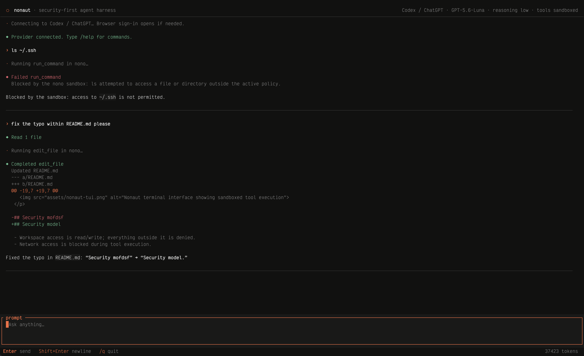

<p align="center">
  
</p>

<p align="center">
  A security-first agent harness powered by <a href="https://github.com/nolabs-ai/nono">nono</a>.
</p>

> **Other harnesses ask the agent to respect a boundary. Nonaut lets it try.
> The boundary remains technically unavoidable.**
>
> A minimal terminal agent where authentication and inference stay in the
> control plane, while every model-requested tool runs in a fresh,
> kernel-enforced sandbox.

## Preview

<p align="center">
  
</p>

## Security model

- Workspace access is read/write; everything outside it is denied.
- Network access is blocked during tool execution.
- Provider credentials and ambient environment variables are not inherited.
- Tool results include concise diffs and sandbox denials.

The TUI and provider connection run normally. Only model-requested execution
crosses the nono boundary.

## Providers

Nonaut currently supports two providers:

- Codex / ChatGPT through the `codex` app-server and your existing login.
- Claude through the official `claude` CLI and subscription login, with
  `ANTHROPIC_API_KEY` available as a fallback.

## Run

Requires Rust 1.99.1. Nono 0.80 is embedded directly, so no separate `nono`
installation is needed.

```sh
make run
```

Nonaut reuses your existing Codex or Claude login and remembers the selected
provider, model, and reasoning effort.

| Command | Action |
| --- | --- |
| `/provider` | Choose or reconnect a provider |
| `/model` | Select a model |
| `/reasoning` | Select reasoning effort |
| `/new` | Start a fresh session |
| `/exec <command>` | Run a command directly inside nono |
| `/clear` | Clear the screen |
| `/detach` | Keep the session running and return to the shell |
| `/q` | Quit |

`Shift+Enter` inserts a newline. `Esc` interrupts an active response. Sending a
new prompt while streaming interrupts the current response first.

`/exec` does not require a connected provider. It runs through the same fresh,
workspace-only nono sandbox used for agent tool calls, which makes policy and
denial testing immediate:

```text
/exec ls .
/exec ls ~/.ssh
/exec printf 'hello\n' > test.txt
```

The same path is available without opening the TUI, which is useful for scripts
and policy checks:

```sh
nonaut exec -- "ls ."
nonaut exec -- "ls ~/.ssh"
```

Detached sessions keep their active provider and conversation in a local
worker. They are created only when `/detach` is used and expire after 24 hours
while detached.

```sh
nonaut ps
nonaut attach <session>
nonaut kill <session>
nonaut kill --all # -a also works
```

Session metadata follows XDG and is stored under
`$XDG_STATE_HOME/nonaut/sessions`, defaulting to
`~/.local/state/nonaut/sessions`. Provider credentials are never copied into
session metadata.

## Development

```sh
make check
make integration
```

`make integration` runs provider-free black-box tests against the real nono
sandbox and terminal interface. `make fmt`, `make lint`, `make test`,
`make build`, `make smoke`, and `make run` are also available.

## Limitations

- Claude subscription access requires the official Claude Code CLI.
- Nonaut does not restore conversations after restart. Provider CLIs may retain
  their own local session data.

## Releases

Push a version tag matching `Cargo.toml`, such as `v0.0.1`, to publish signed
build provenance, checksums, and binaries for Linux and macOS on x86_64 and
ARM64.

## License

Licensed under the [Apache License 2.0](LICENSE).
